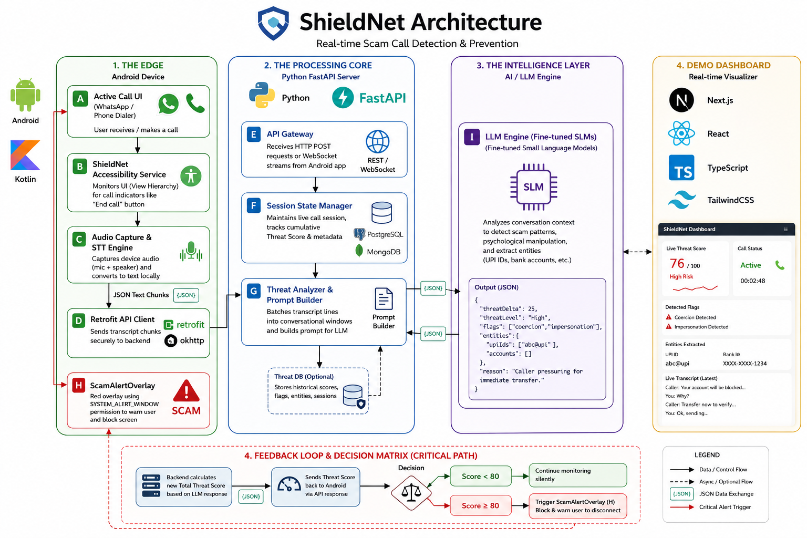
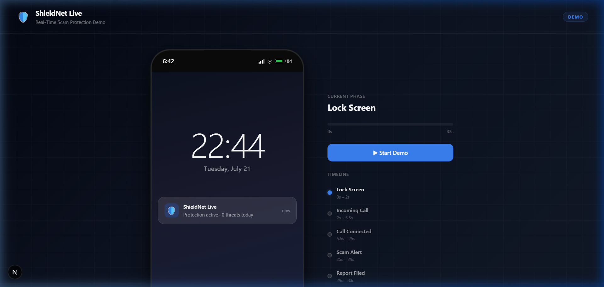
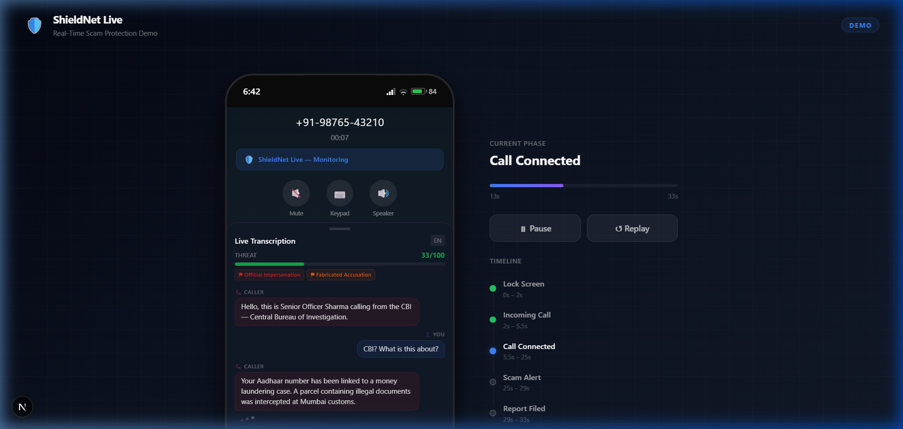
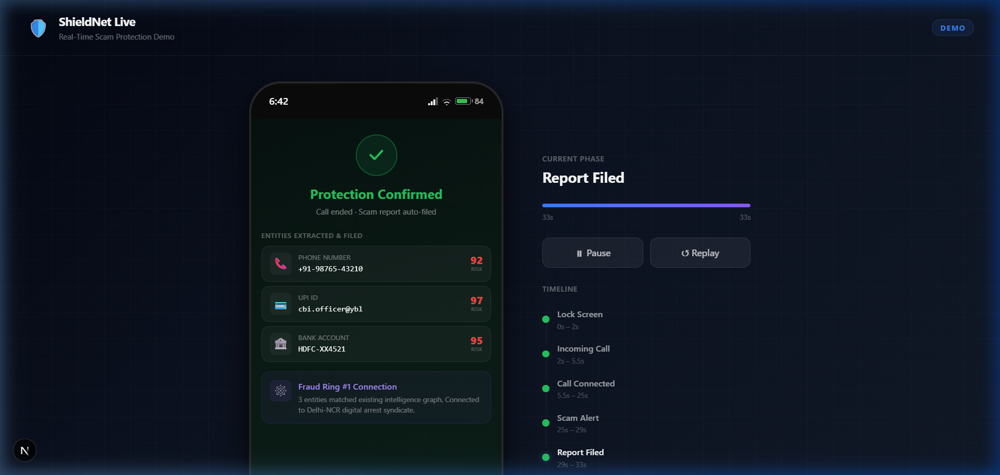

<div align="center">
  
  <h1>🛡️ ShieldNet</h1>
  <p><strong>Enterprise-Grade Fraud Mitigation & Digital Public Safety AI Platform</strong></p>
  
  <p>
    <a href="https://github.com/nabro356/TrustShield/stargazers"></a>
    <a href="https://github.com/nabro356/TrustShield/network/members"></a>
    <a href="https://github.com/nabro356/TrustShield/issues"></a>
    <a href="https://github.com/nabro356/TrustShield/blob/main/LICENSE"></a>
  </p>
</div>

---

ShieldNet is a state-of-the-art, event-driven multi-agent platform designed to proactively tackle organized cybercrime, counterfeit currency circulation, and digital scams in real-time across multiple platforms. By combining multi-modal AI models and graph theory, ShieldNet acts as a digital immune system for the modern web and telecom ecosystem.

## 🌟 Key Capabilities

- **🤖 Multi-Modal AI Agents**: Utilizes asynchronous workers to process diverse data streams, including image analysis (Fine Tuned SLMs / Gemini 2.0 Flash Vision), audio transcriptions, and text logs to detect fraudulent patterns with high accuracy.
- **🕸️ Graph AI & Analytics**: Employs advanced entity resolution and community detection algorithms (using Neo4j) to uncover structured scam syndicates, tracking how malicious actors are connected.
- **⚡ Real-Time Threat Streaming**: High-throughput FastAPI WebSocket connections push live threat updates, alerts, and telemetry directly to the command center without delay.
- **📱 On-Device Mobile Protection**: A native Android client leveraging Android Accessibility Services to screen live calls, SMS messages, and digital interactions in real-time to alert users of potential scams *before* they fall victim.
- **💻 Command & Control UI**: A modern Next.js interface featuring interactive D3-based graph visualizers, live geospatial threat maps, and a file sandbox for deep forensic analysis.

---

## 📸 Dashboard & Mobile Previews

Here is a look at ShieldNet in action, screening threats and protecting users in real-time:

### Start & Simulation

*Initiating the threat simulation and connecting to the live ShieldNet engine.*

### Live Call Screening & Detection

*The native Android service screening an incoming call for malicious patterns and intent in real-time.*

### Actionable Threat Reporting

*Generating an automated forensic report of the detected threat for law enforcement and analytics.*

---

## 🏗️ System Architecture

Our repository is structured to separate concerns while maintaining a unified monorepo for seamless development:

```text
shieldnet/
├── android/            # 📱 Native Android Client
│   ├── app/            # Kotlin-based app with AccessibilityService
│   │   ├── api/        # Retrofit API clients connecting to backend
│   │   ├── service/    # Call screening & transcription services
│   │   └── ui/         # Scam alert overlays & user interfaces
│   └── build.gradle.kts
│
├── backend/            # 🧠 FastAPI Command Center & AI Engine
│   ├── app/
│   │   ├── agents/     # Vision, NLP, and Graph Agents
│   │   ├── graph/      # Graph algorithms & community detection
│   │   ├── api/        # REST and WebSocket endpoints
│   │   └── main.py
│   └── requirements.txt
│
└── frontend/           # 💻 Next.js Command & Control Dashboard
    ├── src/
    │   ├── components/ # Graph Visualizer, Map, Sandbox, Phone Demo
    │   └── app/        # Dashboard & Demo views
    └── package.json
```

---

## 🚀 Quick Start Guide

Ready to deploy ShieldNet? Follow these steps to spin up the different components of the platform.

### 1. Backend Engine (FastAPI)
The backend acts as the brain, processing AI streams and maintaining the knowledge graph.
```bash
cd backend
pip install -r requirements.txt
uvicorn app.main:app --reload
```

### 2. Frontend Command Center (Next.js)
The frontend provides the visual interface and dashboards.
```bash
cd frontend
npm install
npm run dev
```

### 3. Native Android App
Open the `android/` directory in Android Studio. Sync the Gradle project and run it on an emulator or a physical device. Ensure you grant Accessibility permissions when prompted to enable real-time screening.

---

## 🛠️ Technology Stack

- **Frontend**: Next.js (React), Tailwind CSS, Framer Motion, D3.js / Vis.js
- **Backend**: Python, FastAPI, NetworkX, Uvicorn
- **Mobile**: Android (Kotlin), Android Accessibility Services, Retrofit
- **AI Models**: Gemini 2.0 Flash Vision, Custom NLP pipelines

---
<div align="center">
  <i>Built to ensure digital safety and build a trusted digital ecosystem.</i>
</div>
